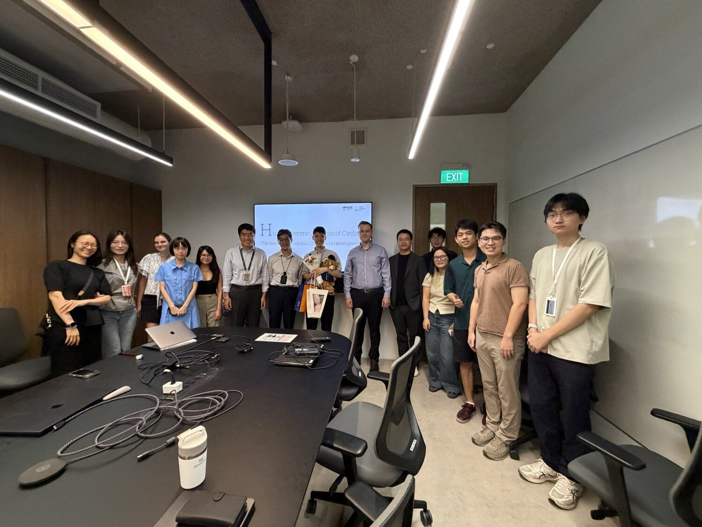
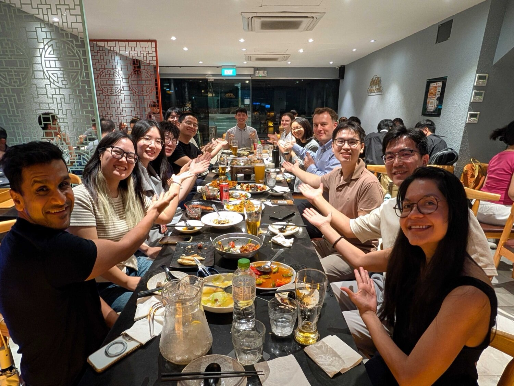

{} successfully defended his PhD thesis _Human-centric Analysis of Cycling: The Nexus of Perception, Choice, and Heterogeneity_ on 28 October 2026.
Many congratulations, Dr Ito!

Koichi was one of the first members of our Lab, joining in AY 2020/21 for his master's thesis in the Master of Urban Planning at NUS, on [assessing bikeability with street view imagery](/publication/2021-trc-bikeability/).
He then won the competitive Singapore International Graduate Award (SINGA), which allowed him to start a very productive PhD with us in 2022.

His doctoral research takes a human-centric perspective on cycling, combining computer vision applied to street view imagery with discrete choice modelling to understand how cyclists perceive streets and choose their routes, with case studies in London, Rotterdam, and Singapore.
His papers appeared in leading journals, including _Transportation Research Part A_, _Computers, Environment and Urban Systems_, and _Annals of the American Association of Geographers_.

One of the most notable outcomes of his PhD is [ZenSVI](/project/zensvi/), an open-source Python package for acquiring, processing, and analysing street view imagery, whose development he led.
It has quickly been taken up by the street view imagery community, and the [paper describing it](/publication/2025-ceus-zensvi/), published in _Computers, Environment and Urban Systems_, is highly cited.
By standardising the whole workflow, ZenSVI makes such research more reproducible and accessible, and it supports many studies in our Lab and worldwide.

Koichi also spent time as a visiting scholar at the MIT Senseable City Lab, the GISense Lab at the University of Texas at Austin, and the CityAI Lab at TU Delft.

His committee consisted of Eddie Lau, Hao Li, Yuan Chao, and Filip Biljecki (thesis advisor).

We are very proud of Koichi. Along the way, he contributed to many projects across our group and played an important role in shaping the Lab's research agenda over the years, for which we are very grateful.
We wish him every success in the next chapter of his career at the Asian Development Bank (ADB).

You can find out more about his work on [his website](https://koichiito.com) and [Google Scholar](https://scholar.google.com/citations?user=WE_g9_WsIAAC&hl=en).

Short abstract of his thesis:

> In this thesis, I examined how urban environments, perceived safety, and individual preferences shape cycling across different cities by combining street view imagery, computer vision, causal inference, and discrete choice modeling within a human-centric framework. In this process, I created ZenSVI, a reproducible Python package for street view imagery analysis, which has gained over 170,000 downloads. The following empirical work also used this package. In London, vegetation, bike lanes, and street lighting increase cycling activity, with effects varying by urban density and deprivation. Perspective correction improves the accuracy of imagery-based bikeability and walkability indicators. In Rotterdam, cyclists accept approximately 64 seconds of additional travel time for a one-unit improvement in perceived safety. In Singapore, device-purchase subsidies produce the most consistent increases in expected cycling frequency, while responses to infrastructure and workplace facilities differ across behavioral groups. Together, these findings show that effective and equitable cycling policy requires attention to differences in how people perceive streets, choose routes, and respond to interventions.

Interested in doing a PhD with us? Have a look at [this guide](/opportunities/application-guide/).
